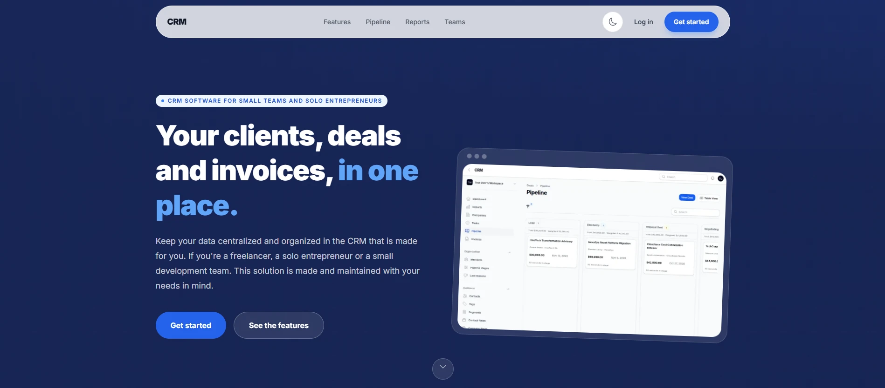
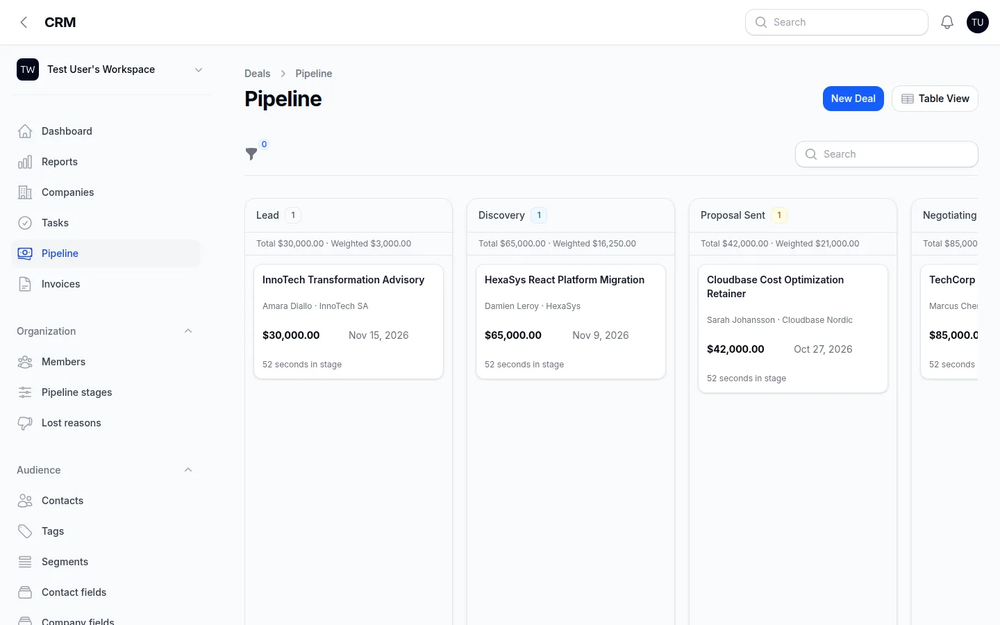

# CRM

A CRM for freelancers, solo entrepreneurs and small teams. It keeps contacts, companies, deals, tasks and invoices in one place, from the first contact to the last payment.

The project is still in active development and not yet ready for production use.



## Features

- **Contacts and companies** with tags, owners, statuses, lead sources and admin-defined custom fields.
- **Activity timeline** for calls, emails, meetings, WhatsApp messages and notes on a contact or a deal.
- **Deal pipeline** as a Kanban board with weighted totals per stage, time in stage, stage history and lost reasons. Stages and win probabilities are configurable.
- **Segments** built from rules (tags, fields, companies, recent activity, open deals) that stay up to date automatically.
- **Tasks** with reminders, snoozing and a daily email digest.
- **Invoices** created from won deals, exported as PDF, with payment and refund tracking.
- **Dashboard and reports**: won revenue, win rate, cash collected, aging of unpaid invoices, forecasts, stage conversion, sales velocity and a team leaderboard.
- **Import and export** of contacts and companies from Excel or CSV, with a downloadable error file for failed rows.
- **Multi-tenant teams**: each organization keeps its own data, with email invites and Owner, Admin, Member and Viewer roles.
- **Global search** across contacts, companies, deals, tasks and invoices.



## Tech stack

- PHP 8.4, Laravel 12
- Filament 5, Livewire 4, Flowforge (Kanban board)
- Inertia 3 and React 19 for the public pages, Tailwind CSS 4
- PostgreSQL, Redis and Laravel Horizon for queues
- Pest for tests, PHPStan (Larastan) and Pint for static analysis and formatting

## Installation

Requirements: PHP 8.4, Composer, Node.js and npm, PostgreSQL and Redis.

1. Clone the repository and enter it:

   ```bash
   git clone https://github.com/AhmedJguirim/crm-project.git
   cd crm-project
   ```

2. Copy `.env.example` to `.env` and set your database (`DB_*`) and Redis credentials.

3. Install dependencies, generate the app key, run the migrations and build the assets:

   ```bash
   composer setup
   ```

4. Optionally, load demo data (an IT consulting workspace):

   ```bash
   php artisan db:seed
   ```

   You can then log in with `test@example.com` / `password`.

5. Start the web server, the queue worker (Horizon) and Vite:

   ```bash
   composer dev
   ```

The app runs at `http://localhost:8000`, and the CRM panel at `/admin`.

To run the tests, static analysis and code style checks:

```bash
composer test
```

## Contributing

Contributions, bug reports and suggestions are welcome. Open an issue or a pull request, or reach me at [jguirimahmed111@gmail.com](mailto:jguirimahmed111@gmail.com).

Before opening a pull request, make sure `composer test` passes.

## License

This project is released under the [MIT License](LICENSE).
